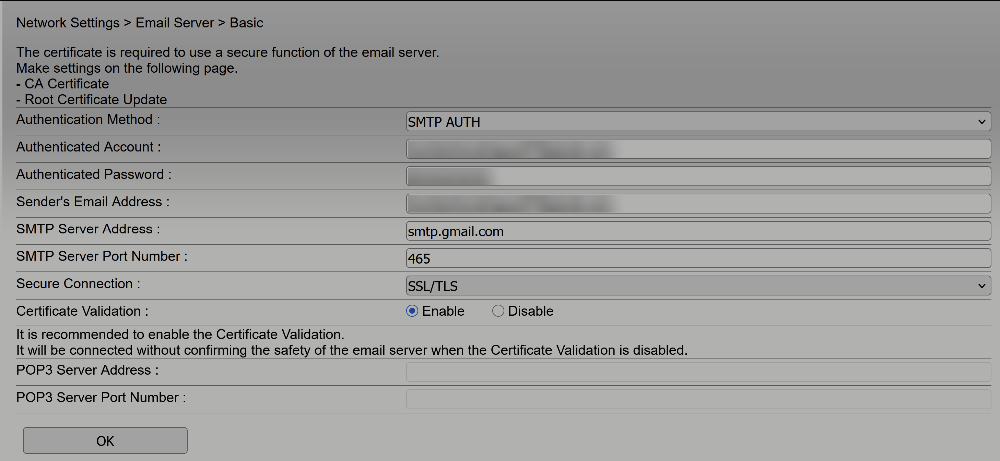
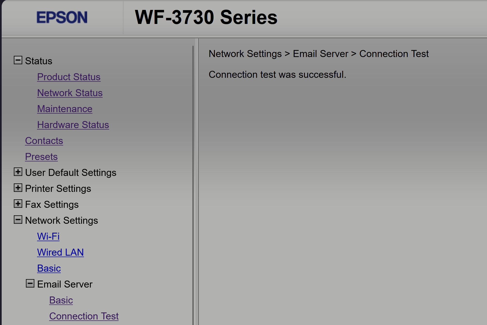

# Epson Scan-to-Email: SMTP Configuration with Gmail App Password

**Device:** Epson WF-3730 Series (Wi-Fi, static IP)
**Category:** Network devices / Printers
**Skills demonstrated:** Layered troubleshooting, SMTP-AUTH over TLS, app-specific credentials

## Symptom

Scanning to email from the printer panel failed with a generic "network error" message.

## Diagnosis

Network layers were checked first, working from the bottom up:

| Layer | Check | Result |
|-------|-------|--------|
| L1/L2 | Wi-Fi link and signal | Connected, signal excellent |
| L3 | IP, subnet mask, default gateway | Valid static configuration |
| DNS | Primary DNS pointed to the router | Resolving, secondary DNS blank |
| L7 | SMTP login to the mail provider | **Failing** |

The network was healthy. The fault was at the application layer: the printer had no valid credentials for the mail server. Gmail rejects a normal account password from devices and apps that cannot complete modern sign-in, so an **App Password** is required.

## Resolution

### 1. Create a Google App Password

1. Sign in at `myaccount.google.com`.
2. Open **Security** and enable **2-Step Verification** (required for app passwords).
3. Open `myaccount.google.com/apppasswords`.
4. Name the password (for example, `Epson Printer`) and click **Create**.
5. Copy the 16-character password and enter it without spaces. Google shows it only once.

!!! note
    App passwords may be unavailable on work or school accounts, accounts with Advanced Protection, or accounts where 2-Step Verification is not fully set up.

### 2. Configure the printer email server

Open the printer's Web Config page at `http://<printer-ip>` and go to **Network Settings > Email Server > Basic**.

| Setting | Value |
|---------|-------|
| Authentication Method | SMTP AUTH |
| Authenticated Account | Full Gmail address |
| Authenticated Password | 16-character app password |
| Sender's Email Address | Same Gmail address |
| SMTP Server Address | `smtp.gmail.com` |
| SMTP Server Port Number | `465` |
| Secure Connection | SSL/TLS |
| Certificate Validation | Enable |

### 3. Verify

Go to **Network Settings > Email Server > Connection Test**. A successful result confirms DNS resolution, TLS negotiation and authentication all work.

A test scan to email was then completed successfully.

## Additional hardening and reliability notes

- Set a **secondary DNS** server (for example, `8.8.8.8`) so a router DNS failure does not break mail delivery.
- Confirm the printer's **date and time** are correct. A wrong clock causes TLS certificate validation to fail.
- Keep **Certificate Validation** enabled so the printer verifies the identity of the mail server.
- Store the app password in a password manager. Revoke it from the Google account page if the printer is retired or compromised.
- Change the default Web Config admin password on the printer.

## Key takeaways

- A generic "network error" on a device does not always mean a network fault. Test each layer before changing settings.
- Use **app-specific credentials** for devices instead of the primary account password. They can be revoked individually without affecting the main account.
- The built-in **Connection Test** confirms the full SMTP path in one step.
