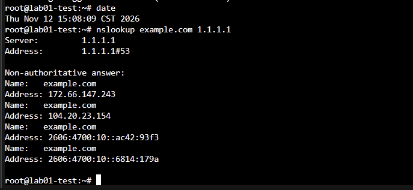
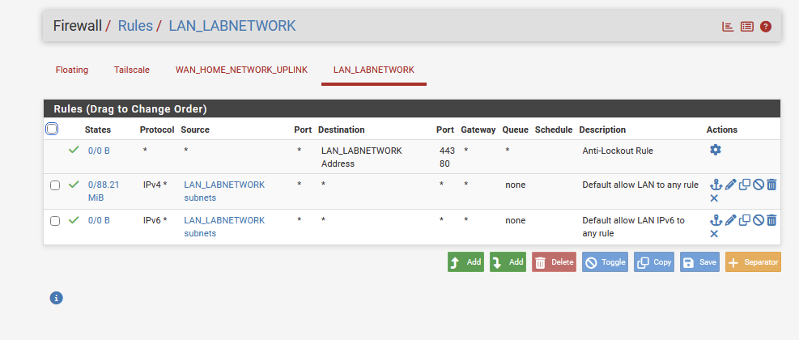
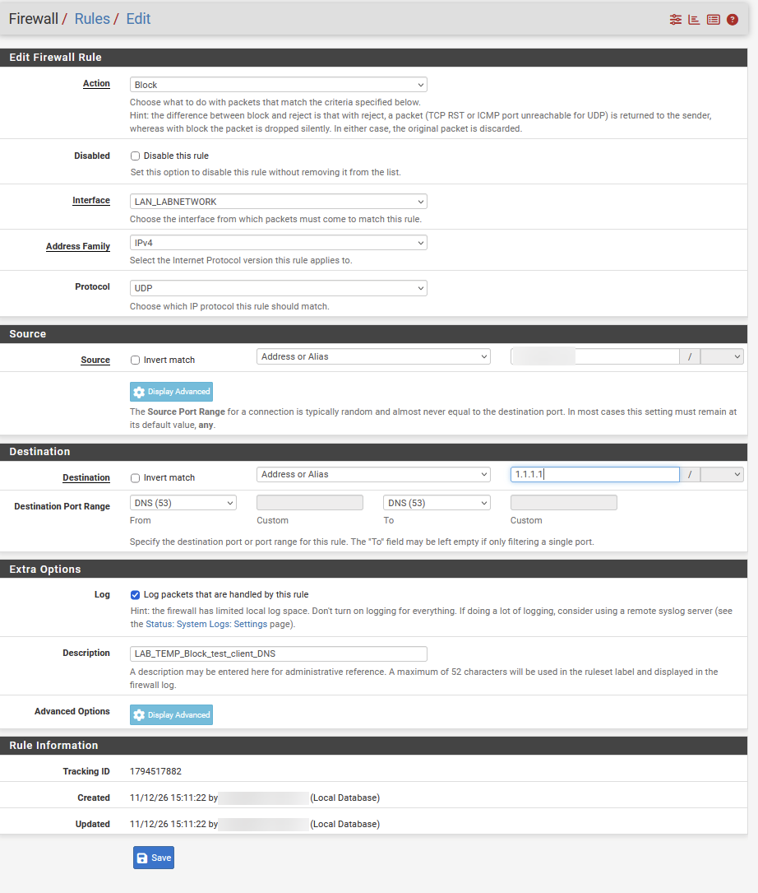
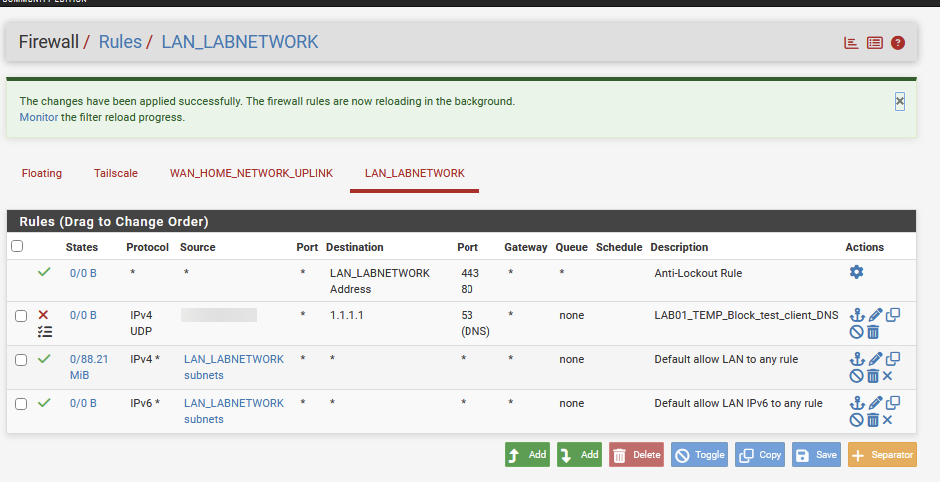
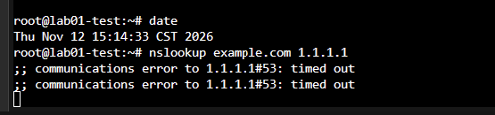
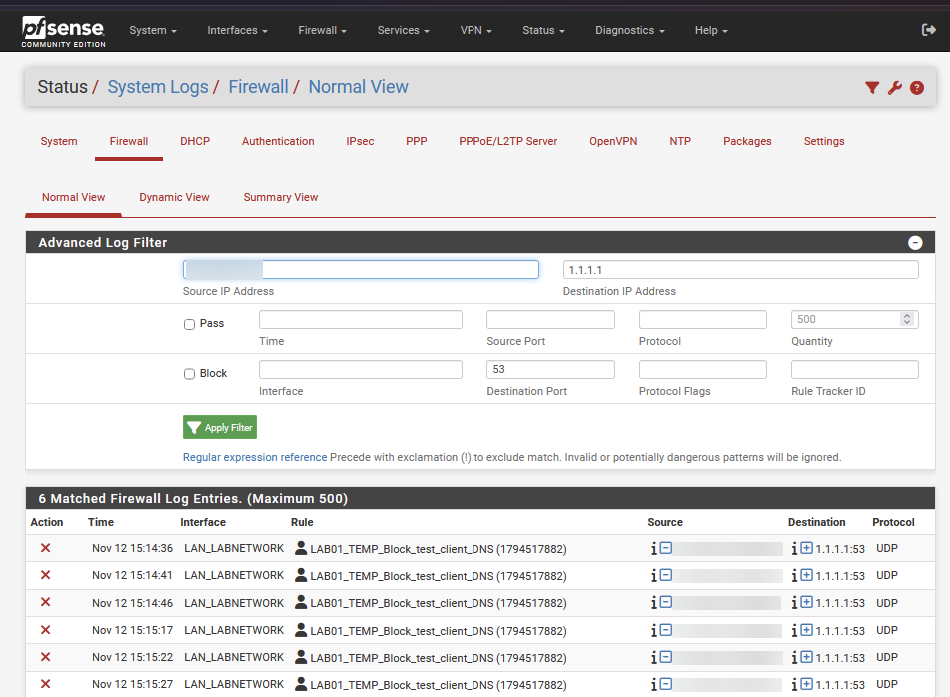
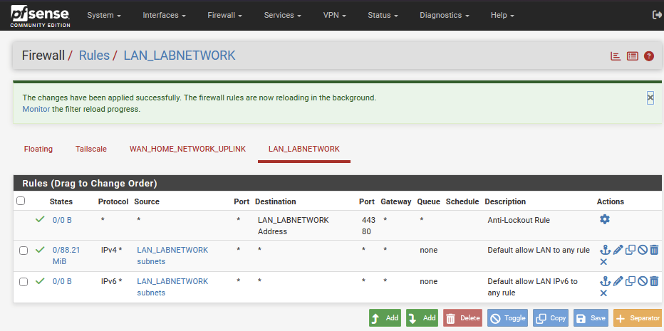
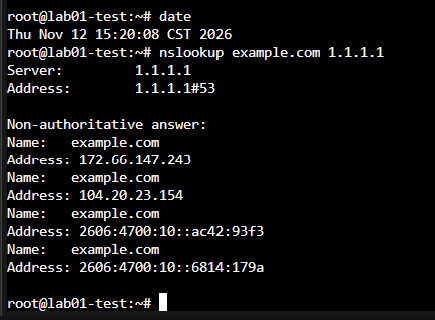
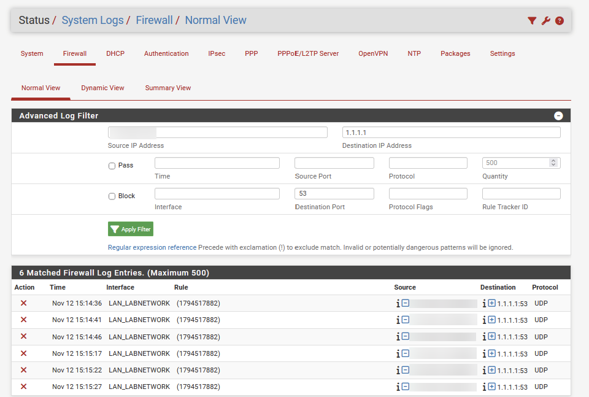

# Lab 01: pfSense Firewall Rule and Log Investigation

**Status:** Complete (personal homelab, not production)
**Date:** November 12, 2026
**Environment:** Proxmox VE 9.2 homelab, pfSense CE 2.8.1-RELEASE
**Skills:** Change control, firewall rule matching, log filtering and correlation, rollback validation

> **Sanitized for publication.** Private lab addresses are blurred in screenshots and replaced with role labels in text:
> `TEST_CLIENT` is a disposable Ubuntu 24.04 container on the lab LAN, and `PFSENSE_LAN` is the pfSense LAN interface.
> `1.1.1.1` (a public DNS resolver) and `example.com` (a reserved test domain) are shown as tested.
> All times are CST (UTC-6).

## Objective

Reproduce a single client DNS failure caused by a firewall rule. Prove that rule caused it using firewall logs, then roll the change back and confirm service is restored.

## Setup

| Item | Value |
|---|---|
| Firewall | pfSense CE 2.8.1-RELEASE (VM on Proxmox) |
| Test client | `lab01-test`, Ubuntu 24.04 LXC, static `TEST_CLIENT`, gateway `PFSENSE_LAN`. Proxmox NIC firewall disabled so pfSense is the only filtering point |
| Protected host | Existing lab server deliberately **not** used for testing |
| Safety | Encrypted pfSense config backup taken before any change (kept private) |
| Clock | Client timezone set to America/Chicago to match pfSense log timestamps |
| Test command | `nslookup example.com 1.1.1.1` (UDP/53) |

## 1. Baseline

Before any change, the query succeeded at 15:08:09.



The LAN ruleset before the change: Anti-Lockout plus the two default allow rules.



## 2. Temporary block rule

| Field | Value |
|---|---|
| Action | Block (silent drop) |
| Interface | LAN |
| Address family / Protocol | IPv4 / UDP |
| Source | `TEST_CLIENT` only |
| Destination | `1.1.1.1`, port 53 (DNS) |
| Logging | Enabled |
| Description | `LAB01_TEMP_Block_test_client_DNS` |
| Position | Below Anti-Lockout, above "Default allow LAN to any" (pfSense uses first match wins) |

### An unexpected result

The first test after creating the rule **still succeeded** at 15:11:36. Instead of assuming the rule worked, I checked it:

- The rule's **Rule Information** showed it was created at 15:11:22, before the successful query. It had been saved, but **Apply Changes** was never clicked, so pfSense was not enforcing it.
- The first draft also had Destination set to **Any**. That would have blocked all DNS from the client, including the internal resolver, so it was broader than intended.

I narrowed the destination to `1.1.1.1` and corrected the description to the `LAB01_TEMP_` naming convention. The screenshot below shows the destination fix and the Tracking ID `1794517882`, captured just before that description change. I then applied the change.





## 3. Reproduce the failure

With the rule active, the query timed out at 15:14:33 and again at 15:15:15. A timeout is what you expect from a Block action: the packet is dropped without any reply, so the client retries until it gives up.



## 4. Correlate with firewall logs

The unfiltered log was full of WAN noise (SSDP multicast and bogon IPv6 from the home network), which pushed the test entries out of the 500-entry view. A targeted filter (source `TEST_CLIENT`, destination `1.1.1.1`, port `53`) returned **6 matched entries**.



| Time | Action | Interface | Proto | Source | Destination | Rule (Tracker ID) |
|---|---|---|---|---|---|---|
| 15:14:36 | Block | LAN | UDP | TEST_CLIENT:45916 | 1.1.1.1:53 | LAB01_TEMP_Block_test_client_DNS (1794517882) |
| 15:14:41 | Block | LAN | UDP | TEST_CLIENT:35412 | 1.1.1.1:53 | same |
| 15:14:46 | Block | LAN | UDP | TEST_CLIENT:38201 | 1.1.1.1:53 | same |
| 15:15:17 | Block | LAN | UDP | TEST_CLIENT:46850 | 1.1.1.1:53 | same |
| 15:15:22 | Block | LAN | UDP | TEST_CLIENT:48077 | 1.1.1.1:53 | same |
| 15:15:27 | Block | LAN | UDP | TEST_CLIENT:33213 | 1.1.1.1:53 | same |

**Why this ties the failure to the rule:**

1. The log's tracker ID `1794517882` matches the Tracking ID on the rule's edit page.
2. The source, destination, port and protocol match the rule's scope exactly.
3. The timestamps match the client's queries: three entries about 5 seconds apart per run, which is nslookup's three retries.
4. Every entry has a different source port, so each one is a new attempt, not leftover connection state.

## 5. Roll back and validate

I deleted only the LAB01 rule and applied the change. The ruleset matches the baseline again.



DNS to 1.1.1.1 worked again at 15:20:08.



Re-running the same log filter showed the same 6 entries (the last at 15:15:27) and **no new blocks after recovery**. Because the rule had been deleted, the log now shows only the tracker ID and no longer shows the rule description. That's a good reason to record tracker IDs during an investigation.



## Timeline (CST)

| Time | Event |
|---|---|
| 15:08:09 | Baseline query succeeds |
| 15:11:22 | Block rule saved (Destination = Any, not yet applied) |
| 15:11:36 | Query still succeeds; investigation finds the rule was never applied and its scope was too broad |
| 15:11:36 to 15:14:33 | Rule narrowed to 1.1.1.1, renamed, positioned and applied |
| 15:14:33 | Query times out |
| 15:14:36 to 15:15:27 | 6 blocks logged across two test runs |
| 15:15:27 to 15:20:08 | Rule deleted and change applied |
| 15:20:08 | Query succeeds; service restored |

## Investigation note

```text
Case: LAB01 — Test Client DNS Failure
Time and timezone: 2026-11-12, 15:08–15:20 CST (UTC-6)
Affected test client: lab01-test (TEST_CLIENT), single host
Symptom and scope: UDP/53 queries from one client to 1.1.1.1 timed out;
  other client traffic, including apt over the internal resolver, unaffected
Suspected cause: Intentional temporary pfSense LAN block rule
Evidence: 6 pfSense log entries, Block, LAN, UDP, TEST_CLIENT:(ephemeral)
  -> 1.1.1.1:53, tracker ID 1794517882 = LAB01_TEMP_Block_test_client_DNS,
  15:14:36–15:15:27 CST
Resolution / rollback: LAB01 rule deleted and applied (between 15:15:27 and
  15:20:08); ruleset matches pre-change baseline; encrypted config backup
  held as fallback
Post-change validation: nslookup example.com 1.1.1.1 succeeded at 15:20:08;
  no new blocks in filtered log after recovery
Business impact in this scenario: One lab client, under 9 minutes, DNS to
  one external resolver only; no other hosts or services affected
```

## Lessons learned

- A saved pfSense rule is not enforced until **Apply Changes** is clicked. Validate every change with a test, not just the config screen.
- Review rule scope before saving. Destination "Any" would have blocked all DNS from the client.
- Raw firewall logs are noisy. Targeted filters on source, destination and port are needed to find the relevant entries.
- A timeout alone is not proof. Correlate the client's symptoms with log entries and the specific rule's tracker ID.
- Normalize timestamps across systems before correlating (the client defaulted to UTC, and pfSense logs in CST).

## Scope of this claim

In my pfSense lab, I created a narrowly scoped firewall policy, reproduced a DNS connectivity failure, correlated it to firewall logs, and validated service restoration after rollback. This was a personal homelab exercise, not enterprise production firewall administration.

## References

1. Netgate, "Firewall Logs," pfSense Documentation. <https://docs.netgate.com/pfsense/en/latest/monitoring/logs/firewall.html>
2. Netgate, "Troubleshooting Firewall Rules," pfSense Documentation. <https://docs.netgate.com/pfsense/en/latest/troubleshooting/firewall.html>
