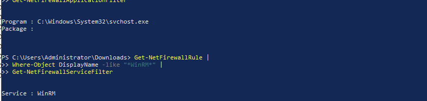
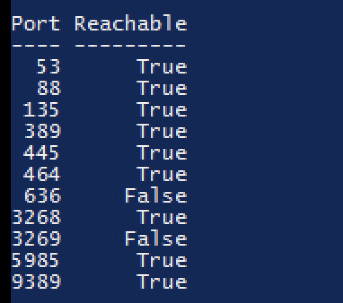

# Application-Aware Firewall Hardening for an Active Directory Domain Controller

*Windows Server 2019 · Windows Defender Firewall · PowerShell · DNS · Kerberos · WinRM · SMB*

!!! info "Portfolio scope"
    This case study summarizes hands-on testing in an **isolated Windows infrastructure practice lab**. Network addresses, names, and screenshots have been generalized or cropped. It is a technical learning exercise, **not a claim of a production-certified security baseline**. In particular, remote SYSVOL read access was not fully resolved at the end of the recorded tests.

## Objective

Harden a Windows Server domain controller against unwanted lateral network connections while preserving the services that authentication, DNS resolution, management, and Group Policy require.

Unlike traffic crossing a routed firewall, same-subnet traffic can pass directly between hosts without reaching the perimeter gateway. I therefore used the host's Windows Defender Firewall to apply **service-aware, executable-aware inbound rules**, then tested those rules from independent Linux and Windows clients.

The project addressed three questions:

1. Can a host-based policy restrict the applications and ports exposed by a domain controller without breaking expected services?
2. How can I distinguish an *open port* from an *authenticated and working service*?
3. What rollback and validation procedures reduce the risk of disrupting Active Directory during hardening?

## Environment

| Component | Role |
| --- | --- |
| Windows Server 2019 Standard | Practice Active Directory Domain Services and DNS server |
| Windows 11 workstation | Remote test client; not joined to the test domain |
| Rocky Linux server | Remote Linux test client |
| Windows Defender Firewall with Advanced Security | Host-based firewall policy and application/service filters |
| PowerShell / `dcdiag` / `netsh` | Server configuration and diagnostics |
| `dig`, `nc`, `ping` | Independent DNS, TCP, and ICMP validation |

The example commands below use `dc01.lab.example.test` and `192.0.2.10`, **documentation placeholders** that must be replaced for a real lab. No competition network, host inventory, credentials, or live addresses are published here.

## Prerequisites and safety controls

- Have direct **VM console** access before changing the firewall. Do not depend solely on an RDP or WinRM session for recovery.
- Confirm the actual network interface, addresses, and required business services before creating or narrowing rules.
- Export the current firewall configuration **before** applying changes:

  ```powershell
  netsh advfirewall export C:\Firewall-Before.wfw
  ```

- Keep a copy of the export outside the VM. A local backup cannot help if the VM or its disk becomes unavailable.
- Avoid deleting all default Windows firewall rules. Their service-specific restrictions and operating-system dependencies may not be obvious. **No destructive replacement script is included in this public project.**
- Inventory effective rules, including those originating from Group Policy, before deciding whether a new rule is redundant.

## Procedure

### 1. Map Windows services to network requirements

I started by identifying the applications and services associated with common domain-controller traffic. The table describes the intended role of each allowance; exact process ownership can differ by Windows build and component.

| Service / purpose | Port(s) | Typical Windows process or service | Policy approach |
| --- | --- | --- | --- |
| DNS | TCP/UDP 53 | `dns.exe` | Application-specific inbound allow |
| Kerberos | TCP/UDP 88 | `lsass.exe` | Restrict to legitimate AD client networks |
| LDAP / DC discovery | TCP/UDP 389 | `lsass.exe` | Restrict to legitimate AD client networks |
| Kerberos password changes | TCP/UDP 464 | `lsass.exe` | Keep while password change functionality is required |
| Global Catalog | TCP 3268 | `lsass.exe` | Allow where queried |
| RPC Endpoint Mapper | TCP 135 | Windows RPC service | Scope carefully; confirm actual matching behavior |
| Dynamic RPC | High TCP ports, typically 49152–65535 | Several Windows processes | Avoid blanket internet exposure; test actual role dependencies |
| SYSVOL and NETLOGON / SMB | TCP 445 | Windows SMB server / `System` | Allow authenticated clients that need Group Policy |
| Windows Time | UDP 123 | `W32Time` | Allow domain time synchronization |
| Active Directory Web Services | TCP 9389 | AD Web Services | Allow approved administration clients |
| PowerShell Remoting | TCP 5985 | WinRM service | Allow authorized management sources and verify authentication |
| ICMP Echo Request | ICMPv4 | OS/network stack | Allow as needed for monitoring and diagnostics |

Ports **636** (LDAPS) and **3269** (TLS Global Catalog) are conditional: opening them in a firewall does not configure TLS listeners or certificates. Likewise, a successful TCP test is not proof of valid authentication.

### 2. Inspect application and service filters

Windows Firewall can bind rules to executable paths and, for eligible Windows services, service names. Rather than allowing all traffic belonging to `svchost.exe` or `lsass.exe`, I examined how each custom rule matched a program and a listening port.

Read-only checks:

```powershell
Get-NetFirewallRule |
    Where-Object DisplayName -Match 'DNS|Kerberos|WinRM|SMB' |
    Select-Object DisplayName, Enabled, Direction, Action

Get-NetFirewallRule |
    Where-Object DisplayName -Match 'WinRM' |
    Get-NetFirewallApplicationFilter

Get-NetFirewallRule |
    Where-Object DisplayName -Match 'WinRM' |
    Get-NetFirewallServiceFilter
```

The archived screenshot below shows the original WinRM rule's executable and service associations. The image is cropped to exclude the practice environment's identifiers.



*Evidence: querying the WinRM application filter (`svchost.exe`) and service filter (`WinRM`). These associations were visible, but remote TCP connectivity still initially failed.*

### 3. Apply and review a staged policy

The staged policy retained **inbound Block by default** with explicit allows for legitimate services. Outbound was **temporarily Allow by default** while dependencies such as DNS forwarding, NTP, and Windows management were inventoried. This was an availability-first *baseline*, not a fully implemented outbound allowlist.

A **minimal example** of an application-bound DNS rule (not an entire DC policy) is:

```powershell
$dnsExe = Join-Path $env:SystemRoot 'System32\dns.exe'
$approvedClients = '192.0.2.0/24' # Replace with your authorized lab subnet

New-NetFirewallRule -DisplayName 'LAB DNS UDP 53' `
    -Direction Inbound -Action Allow -Profile Domain `
    -Program $dnsExe -Protocol UDP -LocalPort 53 `
    -RemoteAddress $approvedClients
```

I also kept TCP 53 available: DNS responses may use TCP, including when a UDP response is truncated. A client successfully querying a DNS server over UDP does **not** establish that TCP can safely be disabled.

Application and service filters were applied carefully to `lsass.exe`, `dns.exe`, and other components. **SMB traffic should not be naively bound to `lsass.exe`;** the Windows SMB server and kernel network stack are involved.

### 4. Troubleshoot a WinRM rule that matched too narrowly

One of the most useful problems emerged during validation:

1. WinRM responded locally, and a service/executable-bound rule existed.
2. A remote Linux client could ping the server and query its DNS, but the WinRM TCP connection **timed out**.
3. I temporarily tested a TCP/5985 allow rule without a program/service restriction, limited to the approved lab subnet.
4. Remote TCP/5985 immediately connected; repeated tests succeeded after the temporary rule was replaced with a persistent, port-based rule.
5. I retained the narrower network scope and documented the limitation rather than claiming I had isolated the exact Windows Filtering Platform mismatch.

Sample diagnostic commands:

```powershell
# On the Windows domain controller
Get-Service WinRM
Get-NetTCPConnection -LocalPort 5985 -State Listen
Test-WSMan localhost
```

```bash
# On a remote Linux test host
nc -vz -w 3 192.0.2.10 5985
```

**Lesson:** A firewall rule can look correct in the GUI while still failing the actual traffic match. A temporary controlled rule is useful for isolation, but the fact that it works does not identify the exact underlying service-filter behavior. TCP reachability also does **not** prove remote authentication.

### 5. Validate from independent clients

I used a Rocky Linux VM and a Windows 11 VM to test network paths **from outside the DC itself**.

On Windows:

```powershell
$server = '192.0.2.10' # Documentation example: substitute your actual DC
$ports = 53, 88, 135, 389, 445, 464, 3268, 5985, 9389

foreach ($port in $ports) {
    $test = Test-NetConnection $server -Port $port -WarningAction SilentlyContinue
    [PSCustomObject]@{
        Port = $port
        TcpReachable = $test.TcpTestSucceeded
    }
}
```

On Linux:

```bash
# Replace the documentation IP with your DC
ping -c 4 192.0.2.10
dig @192.0.2.10 lab.example.test SOA
dig +tcp @192.0.2.10 lab.example.test SOA
nc -vz -w 3 192.0.2.10 5985
```



*Evidence: cropped PowerShell results from the Windows workstation. All listed tested TCP ports responded. The original hostname and network identifiers are deliberately omitted.*

### 6. Verify Active Directory readiness, not merely open sockets

On the domain controller:

```powershell
dcdiag /test:DNS /test:Advertising /test:SysVolCheck /test:NetLogons
Get-Service DNS,NTDS,KDC,Netlogon,WinRM,ADWS,DFSR
net share
```

I then ran a local authenticated WinRM test:

```powershell
Invoke-Command -ComputerName dc01.lab.example.test `
    -ScriptBlock { hostname; whoami }
```

The corresponding local test completed successfully in the practice environment. **A remote authenticated WinRM execution test was not conclusively completed**, despite the successful remote TCP/5985 and WSMan endpoint checks.

## Verification results

| Check | Observed result | What it demonstrates |
| --- | --- | --- |
| ICMP from Rocky Linux | Passed, 0% loss | Remote IP reachability from that host |
| DNS SOA query using UDP | Passed | DNS service responds to a real query |
| DNS SOA query using TCP | Passed | DNS TCP fallback path works |
| TCP ports 53, 88, 135, 389, 445, 464, 3268, 5985, 9389 | All connected | Those TCP endpoints were reachable from the test workstation |
| TCP ports 636 and 3269 | Did not connect | TLS listeners were not confirmed/configured; not necessarily a defect |
| `Test-WSMan` from Windows 11 | Passed | Remote WSMan endpoint responds |
| `Invoke-Command` on the DC to its own FQDN | Passed | Local authenticated remoting works |
| `dcdiag` SYSVOL and NetLogons checks | Passed | DC's local SYSVOL readiness and share registration |
| SMB `IPC$` session from workgroup Windows 11 | Connected | A network SMB session was established |
| Remote SYSVOL directory listing | **Unresolved: Access denied** | Port 445 and share enumeration alone did not establish file-level access |
| Remote authenticated WinRM execution | **Not conclusively verified** | Requires a separately authorized remote account/session |

### Follow-up issue: DNS resolver choice and SYSVOL access

The Windows 11 workgroup test client initially used public recursive DNS rather than the lab DC. Consequently, its normal lookup of the private AD hostname failed even though the explicit DNS query to the DC succeeded. After switching the client's configured DNS resolver to the DC, hostname resolution succeeded and TCP/445 was reachable by name.

The workstation could enumerate the `SYSVOL` and `NETLOGON` shares and establish an `IPC$` session, but an actual `SYSVOL` directory read still returned **Access denied**. The domain controller's `dcdiag /test:SysVolCheck /test:NetLogons` passed locally. This remaining issue should be investigated through the user's effective SMB identity, share/NTFS ACLs, and the DC Security log, rather than 'fixed' by granting broad permissions.

That distinction—**DNS resolution → TCP reachability → authenticated session → resource authorization**—became a core troubleshooting takeaway.

## Troubleshooting decision tree

| Symptom | First check | Avoid assuming |
| --- | --- | --- |
| Destination Host Unreachable | Route, ARP/neighbor table, correct NIC/VLAN | That Windows Firewall is automatically to blame |
| DNS responds with `-Server` but not without it | Client DNS resolver assignment | That the DNS server is broken |
| TCP 5985 times out | Listener, effective firewall rules, program/service filters | That a running WinRM service is externally accessible |
| TCP 5985 connects but remote command fails | Credentials, remoting endpoint, Kerberos/NTLM configuration | That an open port means successful authentication |
| TCP 445 connects but SYSVOL listing fails | SMB session identity, share existence and ACLs | That port 445 alone proves SYSVOL works |
| AD service works locally but not remotely | Compare localhost and remote tests; examine effective firewall policy | That a local green test proves remote availability |

## Security notes and limitations

- **No wholesale rule deletion:** retain built-in service rules unless a validated replacement is available, and preserve a tested rollback path.
- **Scope management paths:** do not leave WinRM, ADWS, SMB, or dynamic RPC broadly accessible from untrusted networks.
- **Treat LSASS as critical:** it supports essential authentication and directory functions; do not use a blanket executable block.
- **Review dynamic RPC carefully:** actual endpoint ownership and required port ranges depend on roles and topology.
- **Don't open ports for unconfigured services:** for example, allowing 636/3269 does not itself enable LDAPS.
- **Protect authentication:** keep WinRM authentication configured securely; do not enable Basic or plaintext traffic simply to get a green connectivity test.
- **Outbound controls remain incomplete:** the tested baseline used outbound default Allow. A genuine egress allowlist requires more analysis and testing.
- **Workstation was not domain-joined:** local and remote credential behavior can differ from a typical enterprise domain client.
- **Evidence was sanitized:** no environment-specific addresses, domain names, secret values, or incident/competition details are included.

## What I learned

1. **Application-aware filters require real traffic validation.** A configured executable/service association does not guarantee the Windows networking stack matches it as expected.
2. **AD hardening is dependency management.** Kerberos, LDAP, DNS, RPC, SMB, Netlogon, and WinRM interact, so a single overrestrictive rule can produce confusing secondary errors.
3. **Use layered tests.** ICMP, DNS queries, TCP handshakes, credentialed remoting, and share access validate different functions.
4. **Keep the rollback as close as the change.** Export the firewall and have VM console access before modifying management rules.
5. **Report unresolved results explicitly.** SYSVOL share presence and `dcdiag` success were valuable—but did not prove remote file authorization.

## Project artifacts

- [Read-only Active Directory firewall audit script](../assets/scripts/ad-firewall-audit.ps1) — exports effective baseline rule information to a CSV without modifying firewall policy.
- Two cropped validation screenshots on this page. Original lab screenshots and raw configuration scripts are deliberately excluded from the public repository.

## References

- Microsoft Learn: [Service overview and network port requirements for Windows](https://learn.microsoft.com/en-us/troubleshoot/windows-server/networking/service-overview-and-network-port-requirements)
- Microsoft Learn: [Configure firewall for AD domains and trusts](https://learn.microsoft.com/en-us/troubleshoot/windows-server/active-directory/config-firewall-for-ad-domains-and-trusts)
- Microsoft Learn: [New-NetFirewallRule (NetSecurity)](https://learn.microsoft.com/en-us/powershell/module/netsecurity/new-netfirewallrule)
- Microsoft Learn: [WinRM installation and configuration](https://learn.microsoft.com/en-us/windows/win32/winrm/installation-and-configuration-for-windows-remote-management)
- Microsoft Learn: [AD domain join troubleshooting](https://learn.microsoft.com/en-us/troubleshoot/windows-server/identity/active-directory-domain-join-troubleshooting-guidance)
